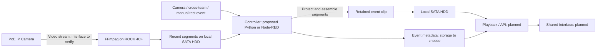

# 系统角色与预录制 / Architecture

状态：**方案整理，待实现/验证**。硬件基线来自用户 2026-10-23 的明确修订。技术角色来自当日讨论；具体产品与协议支持没有在本次归档中重新实测。

## 当前工作流

图示表达方案角色，不是接线图或已部署拓扑。SATA 硬盘的实际供电与连接适配方式还需记录。

| 部分 | 负责什么 | 当前确定程度 |
| --- | --- | --- |
| 摄像头与 PoE 网络 | 影像/编码、传输；可能提供运动事件 | 型号、RTSP/事件接口、PoE 规格需核对 |
| ROCK 4C+ | 承载现场录制和控制；分析负载另测 | 用户确认的设备方向 |
| FFmpeg | 接收视频、生成分段、拼接/裁剪 | 候选工作流；没有归档部署证明 |
| 控制程序 | 接收事件、选时间窗、保护片段、等待尾段、清理与恢复 | 必需的逻辑角色；Python/Node-RED 实现待定 |
| SATA 机械硬盘 | 保存近期缓存、正式录像、原始数据 | 用户确认本地存储；保留策略待定 |
| Node-RED | 流程编排和设备/服务连接 | 不是数据库；不等于另需一整套 Node.js 后端 |
| MQTT / broker | 传递事件、状态和指令 | 跨组协议候选；不承载原始视频的角色 |
| MongoDB / PostgreSQL | 保存可查询的事件、设备、位置、文件索引等 | 数据库候选；不是两套都已选择 |
| 分析程序 | 定位、追踪、候选事件与统计、热阵列处理 | 后续探索；指标和性能待验证 |
| API / 共享界面 | 查找、回放、时间线和跨组记录访问 | 实现及整合负责人待确认 |

## 为什么要持续缓存

若收到 T 时刻事件后才启动录像，触发前画面可能从未保存。当前方向是平时持续接收并暂存近期分段；收到事件后保护覆盖 T−n 的分段，继续收集尾段，再生成正式录像。被保护的事件片段与循环缓存使用不同清理策略。

FFmpeg 的输入缓存能力不等于完整事件录像系统。事件接收、时间窗、片段保护、重复/重叠事件、清理、断流和磁盘失败，需要控制逻辑。分段边界可能受关键帧影响；是否精确裁剪与是否重新编码应通过测试决定。

## 时间与记录约定草案

以下字段是基于讨论的**待协商草案**，不是已确认的全班 schema：`camera_id`、`event_id`、事件源、源事件时间、接收时间、片段起止时间、文件位置、生成状态和失败原因。说明时间源及同步误差，避免将服务器接收时间直接当成画面事件时间。

预录能保留已接收的历史画面，不能恢复从未到达的丢失数据。事件片段也不能单独证明全天活动分布。

## 与旧图的关系

Figma 与展示稿中的 ROCK 5C、SSD、云端服务器保留为历史版本。本页采用新硬件方向；云端是否承担长期保存与远程服务仍未定。服务器是服务角色，不必预先等同于新增一台云端主机。

来源：[主讨论](history/main-videoing.md)、[设计快照](../project-camera/design/README.md)、[决定 D002–D005](DECISIONS.md)。
