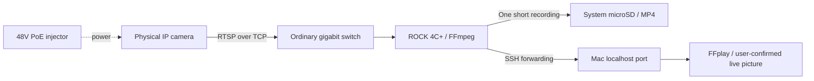
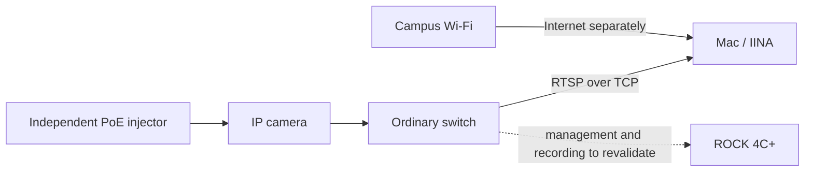
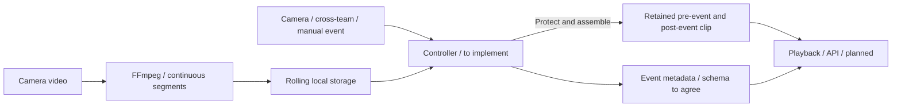

# 系统角色与预录制 / Architecture

更新：2026-10-30。**home 短录及预览、school 网络/AP 和最终 Mac 有线预览已有有限证据；循环分段、事件控制和预录制仍待实现/验证。** 完整范围见 [SCOPE](SCOPE.md)，适用条件见[环境目录](../project-camera/environments/README.md)。

## home 已验证的基础链路

图示仅标明本次证据覆盖的角色。PoE 供电器 LAN 口连接数据网络，POE 输出口连接匹配的摄像头；普通交换机不提供摄像头电源。路由器承担 home 的管理网络接入，具体接线见 [home](../project-camera/environments/home/README.md)。

已验证：ONVIF 只读获取配置和流 URI；RTSP/TCP 主码流接收；约 60 秒保存、完整软件解码和 Mac 动态预览。ROCK 摄像头网段辅助地址与 SSH 本机转发尚未持久化，不是已完成的开机自启服务。

## school 最终有线预览链路

本次已验证 Mac 直接读取相机、三秒解码和用户可见 IINA 预览；末次 ROCK 固定 IPv4/SSH 尚未恢复。该视频路径不要求 ROCK 转发，不能从 Mac 的成功推定板卡录像。学校内的电脑热点、iPhone 和 ROCK AP 是另外的分变体记录；见 [school](../project-camera/environments/school/README.md)。

## 仍待实现的目标链路

项目存储方向继续采用用户确认的 SATA HDD（D002），本次仅以系统卡测试（D012）。SATA 接法、供电、挂载、保留策略和实际性能尚需验证。上图不是已部署拓扑。

| 部分 | 角色 | 当前确定程度 |
| --- | --- | --- |
| 摄像头、供电与交换机 | 输出视频，提供摄像头供电和网络通信 | home 实物标签和基础链路已观察；完整型号/固件、运动通知与 IEEE 供电认证未确定 |
| ROCK 4C+ | 现场接收、录像、控制与访问 | Debian 12 / aarch64，已实际运行短采集；负载和长期能力未验证 |
| FFmpeg | 接收、封装、分段/拼接等媒体操作 | 5.1.9 的短录封装和解码已实测；循环分段和预录尚未实现 |
| 控制程序 | 事件、时间窗、片段保护、尾段等待、清理和恢复 | 完整控制逻辑未实现；测试中用 Python 标准库读取 ONVIF |
| 系统 microSD | 本阶段测试视频文件 | home 基础短测试通过，不作为正式保留策略 |
| SATA HDD | 项目本地正式存储方向 | 本次未验证 |
| SSH + FFplay | Mac 查看板卡可达的视频 | home 用户确认动态画面；本机端口转发，不新增公网视频服务；延迟未量测 |
| IINA / Mac 有线网口 | 摄像头经交换机直接在 Mac 预览 | school 最终用户确认可见，短解码通过；软件解码、RTSP/TCP、无录制；持续性能未测 |
| Node-RED / Python 框架 | 编排或定制控制/分析 | 完整框架组合仍待选择；Node-RED 不是数据库 |
| MQTT / broker | 事件、状态和指令 | 跨组候选，不承担原始视频传输 |
| MongoDB / PostgreSQL | 元数据、设备和文件索引 | 候选，并非两套均已选定 |
| 分析、API 与共享界面 | 定位、轨迹、候选行为、查询和整合 | 后续探索；指标、协议和负责人仍待验证/确认 |

## 为什么仍需要预录控制

触发之后才开始接收和保存，无法补回之前没有保留的画面。目标机制是平时持续接收近期分段，事件到来后保护覆盖 T−n 的内容，继续等尾段，再生成保留录像。

FFmpeg 的输入缓存不等于完整事件系统。时间窗、分段保护、重叠事件、清理、断流和磁盘失败仍需控制逻辑。关键帧对分段边界的影响也要实测，不能以此次连续短录代替预录验收。

## 时间与记录约定

home 的画面叠加日期与实际测试日期不符，日志还有未设置时间戳及两处 DTS 修正警告。录像可解码不等于时间准确，应分别记录相机时间、板卡接收时间与媒体时间，再核对实际边界。

实验必须写环境 ID；生产事件字段仍是待协商草案：`camera_id`、`event_id`、事件源、源事件时间、接收时间、片段起止、文件位置、生成状态和失败原因。此草案不是已批准的全班 schema。

不可见和断流保持缺口；预录不能补回未收到的数据。仅凭事件片段不能推算全天活动或健康状态。

## 环境与旧方案

home、学校和热点的地址分配、设备互通与管理路径分开记录。学校或热点可能有客户端隔离，互联网可用不等于摄像头/ROCK/Mac 互通。真实地址和访问参数留本地，仓库保存拓扑、示例与验证结果。

ROCK 5C、SSD、云端与旧摄像头芯片/商品参数仍保留在历史展示和 Figma 中。当前设备与实测以 [home](../project-camera/environments/home/README.md)、[school](../project-camera/environments/school/README.md)及 D002/D011/D012/D013 为入口；云端服务仍未定。
