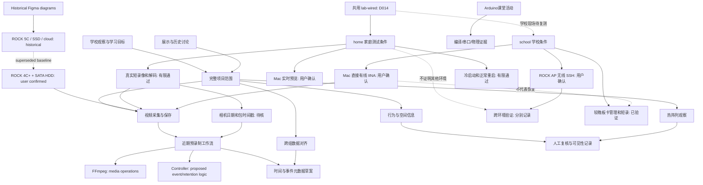

# 知识网 / Knowledge network

版本 1.3 · 更新日期 2026-11-05。对应[机器可读图 GRAPH.json](GRAPH.json)。本图由既有材料整理，用于找到概念、决定、成果与验证之间的关系；不把关系线视为因果证明或已实现的数据链。

home 有历史短录/预览及 11-05 共用网络恢复/重启；school 同日较晚阶段完成板卡短录，和较早网络记录分开。D014 统一日常配置，新基线学校现场仍待复测；通用热点、SATA、预录、长期和异常恢复仍待验证。见[共用指南](../docs/guides/SHARED_WIRED_NETWORK_GUIDE.md)、[home 恢复](../project-camera/experiments/2026-11-05-home-wired-recovery/README.md)与[学校后续短录](../project-camera/experiments/2026-10-30-school-camera-recording/README.md)。

## 如何读取

| 关系 | 含义 |
| --- | --- |
| `defines_scope` / `includes` | 文档描述范围或范围包含某能力，不表示完成 |
| `user_confirms` / `supersedes` | 用户明确事实与旧基线之间的修订 |
| `proposed_role` / `depends_on` | 建议的角色或验证依赖，不表示已部署 |
| `documents` / `evidence_for` | 材料记录某项内容或支持指定范围的观察 |
| `requires_validation` | 明确待验证或待协商的部分 |

图中的每条 JSON 关系都列出状态、来源路径和理由。新的关联应有独立价值；不把所有概念相互连接，也不把旧提案提升为已确认实现。

关键来源：[SCOPE](../docs/SCOPE.md)、[ARCHITECTURE](../docs/ARCHITECTURE.md)、[DECISIONS](../docs/DECISIONS.md)、[EVIDENCE](../docs/EVIDENCE.md)、[历史讨论](../docs/HISTORY.md)。
